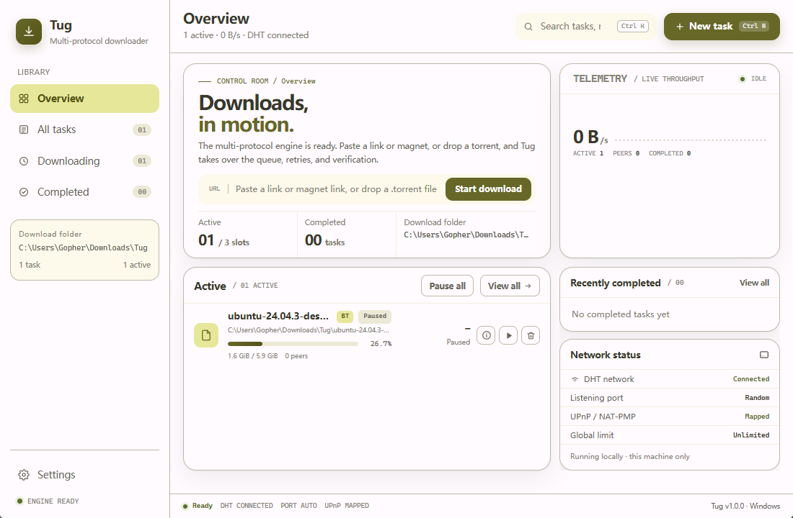
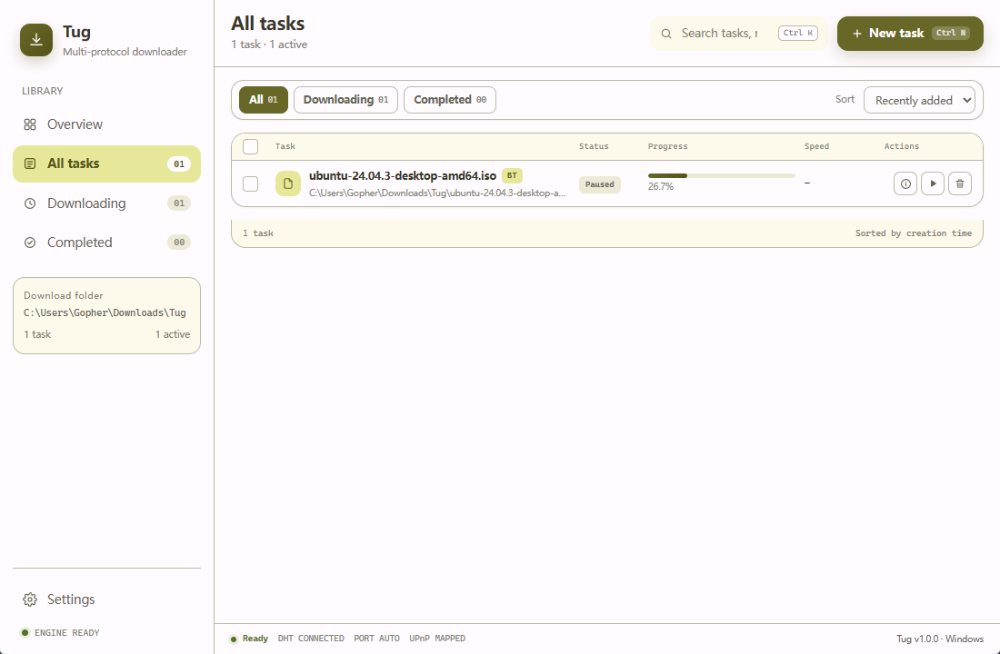
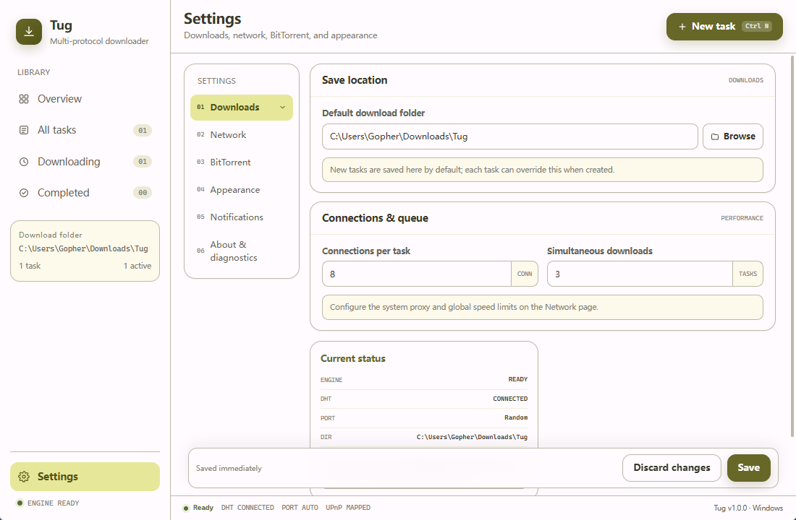
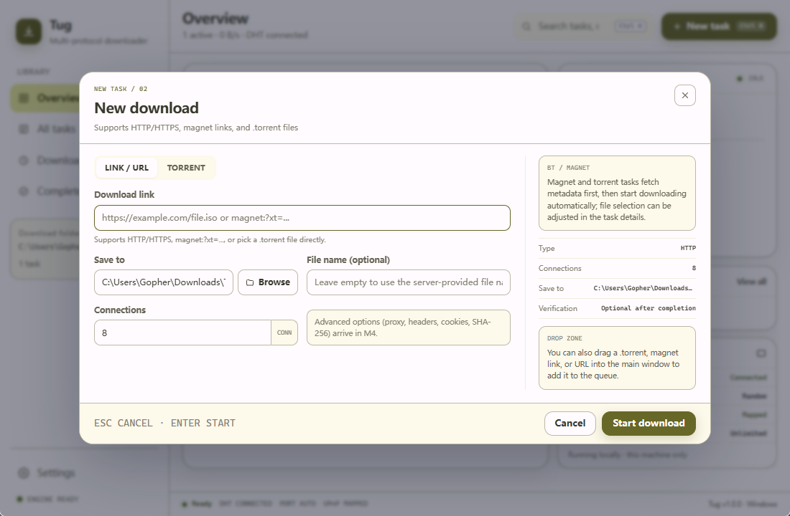

<h1 align="center">
   Tug Desktop
</h1>

<p align="center">Windows desktop downloader · HTTP/HTTPS · BitTorrent · Magnet links · Multi-connection · Resume support</p>

<p align="center">
  <a href="https://github.com/mtdhllf/Tug-Desktop/releases/latest"></a>
  
  
  
  
</p>

<p align="center">
  <a href="README.md">简体中文</a> · <b>English</b>
</p>

<p align="center">
  Current version <b>v1.0.0</b> · Android version: <a href="https://github.com/mtdhllf/Tug-Android">Tug-Android</a>
</p>

---

## Project Highlights

- ✅ A complete Windows desktop downloader: one unified task queue for HTTP/HTTPS, BitTorrent, and magnet links
- ✅ Rust download core (HTTP/BT/scheduling/CLI) + React 19 + Tauri 2 desktop shell
- ✅ Desktop integration including tray, notifications, single instance, clipboard detection, and torrent drag-and-drop
- ✅ Olive-green Material color scheme and icons consistent with the Android app
- ✅ NSIS installer + portable zip

## Download

| File | Description |
|---|---|
| [Tug-1.0.0-x64-setup.exe](https://github.com/mtdhllf/Tug-Desktop/releases/download/v1.0.0/Tug-1.0.0-x64-setup.exe) | Windows 10/11 x64 installer |
| [Tug-1.0.0-portable.zip](https://github.com/mtdhllf/Tug-Desktop/releases/download/v1.0.0/Tug-1.0.0-portable.zip) | Portable version, no installation needed |
| [SHA256SUMS.txt](https://github.com/mtdhllf/Tug-Desktop/releases/download/v1.0.0/SHA256SUMS.txt) | Download checksums |

For more versions, see [GitHub Releases](https://github.com/mtdhllf/Tug-Desktop/releases).

## Screenshots

| Overview | All Tasks |
|---|---|
|  |  |

| Settings | New Download |
|---|---|
|  |  |

## Features

### Downloads

- HTTP/HTTPS downloads with multi-connection segmented acceleration
- Resume support with `.part` temporary files
- Download rate limit (MB/s), connection count, and concurrent task count
- System proxy toggle, with direct connection or system proxy
- Optional SHA-256 verification
- Redirects, timeouts, retries, and error states

### BitTorrent

- `.torrent` files and magnet links
- DHT, UPnP, and listening port configuration
- File selection, Peers / Trackers details
- Upload rate limit
- Keep seeding after the download completes (optional)
- Restore unfinished tasks after a restart

### Task Management

- Overview, All Tasks, Downloading, Completed
- The Downloading list includes: Downloading, Queued, Paused, Failed
- Retry failed tasks directly
- Search, status filter, sorting, multi-select
- Pause, resume, and delete tasks
- Optionally delete downloaded files along with the task
- Tasks persisted to SQLite

### Desktop Integration

- Tray menu, close to tray
- Single-instance execution
- Download completion notifications
- Clipboard link/torrent detection (can be disabled)
- Drop a `.torrent` file to create a new task directly
- Light / dark / follow system theme
- Chinese UI
- Native title bar color follows the theme

### Settings

- Downloads: directory, connection count, concurrency
- Network: system proxy, global rate limit
- BitTorrent: DHT, UPnP, port, upload rate limit, seed after completion
- Appearance: theme, language
- Notifications and tray
- About and diagnostics

### CLI

- `tug paths` / `tug settings`
- HTTP downloads
- BT magnet/torrent downloads

---

## Tech Stack

| Layer | Choice |
|---|---|
| Core | Rust 2024 |
| HTTP | reqwest + segmented downloads |
| BT | librqbit |
| Desktop shell | Tauri 2 + WebView2 |
| UI | React 19 + TypeScript + Vite |
| Storage | SQLite (tasks) + JSON (settings) |
| Packaging | NSIS (per-user) + portable zip |

Supports Windows 10/11 x64.

---

## Quick Start

Requirements:

- Rust stable (MSVC toolchain)
- Node.js 22+
- Visual Studio 2022 Build Tools
- WebView2 Runtime

```powershell
cd apps\desktop
npm install
npm run tauri -- dev
```

Root scripts:

| Script | Purpose |
|---|---|
| `dev.cmd` | Development mode (Vite + Tauri) |
| `run.cmd` | Build release, then launch |
| `run.cmd debug` | Build debug, then launch |
| `test.cmd` | Frontend build, fmt, clippy, all tests |
| `test.cmd quick` | Run Rust tests only |
| `package.cmd` | Produce the NSIS installer + portable zip |
| `cli.cmd <args>` | Invoke the headless CLI |

---

## Build & Test

```powershell
# Frontend
npm --prefix apps/desktop run check
npm --prefix apps/desktop run build

# Rust
cargo fmt --all -- --check
cargo clippy --workspace --all-targets -- -D warnings
cargo test -p tug-core -p tug-http -p tug-torrent -p tug-service
```

Build the installer:

```powershell
.\package.cmd
```

Artifacts are written to `artifacts\v1.0.0\`.

---

## Directory Layout

```text
crates/
  tug-core/       # Config, task database, logging, paths
  tug-http/       # HTTP segmented download engine
  tug-torrent/    # librqbit BT adapter
  tug-service/    # Task scheduling, queue, lifecycle
  tug-cli/        # Headless CLI
apps/desktop/
  src/            # React frontend
  src-tauri/      # Tauri entry point and commands
  public/         # Frontend static assets and icons
scripts/          # Shared environment detection for the root scripts
packaging/        # NSIS packaging resources
```

---

## License

Apache License 2.0, see [LICENSE](LICENSE) for details.
