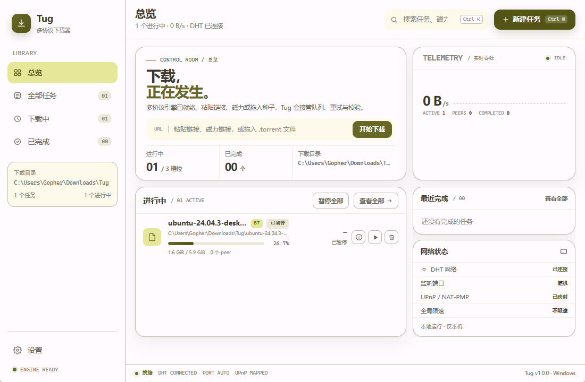
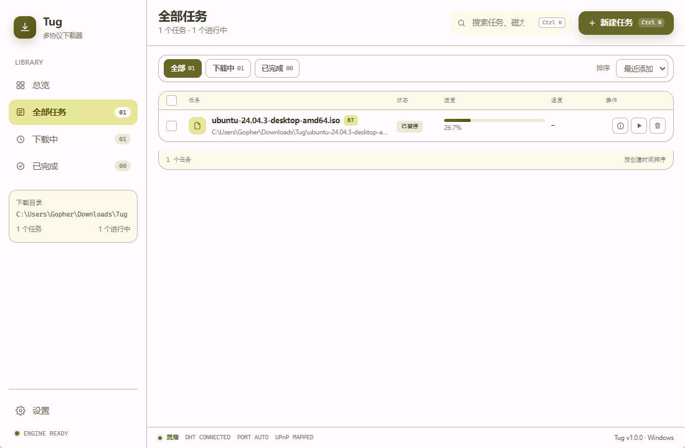
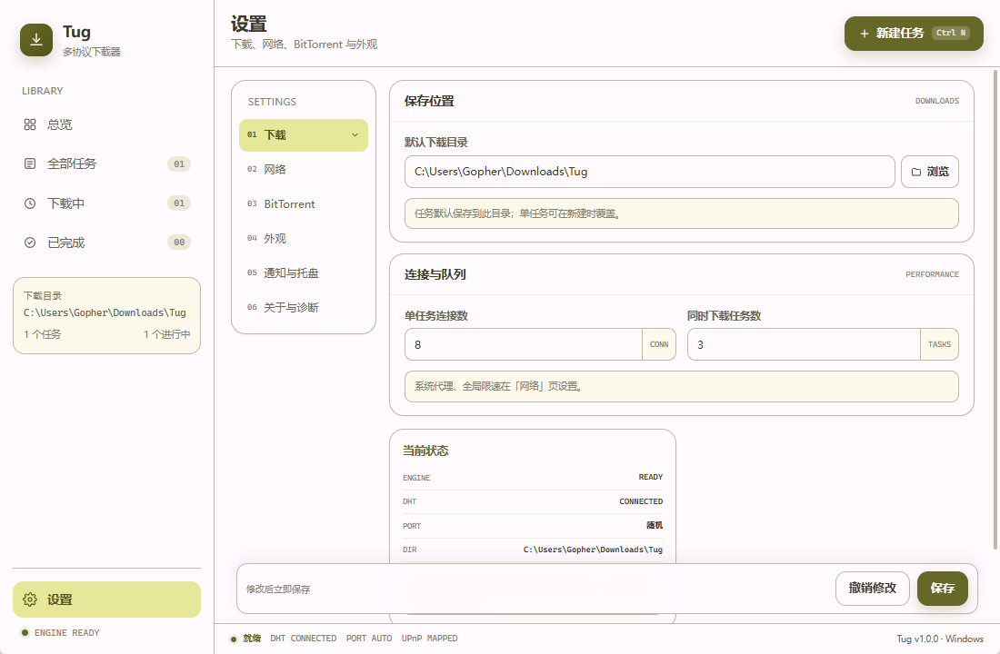
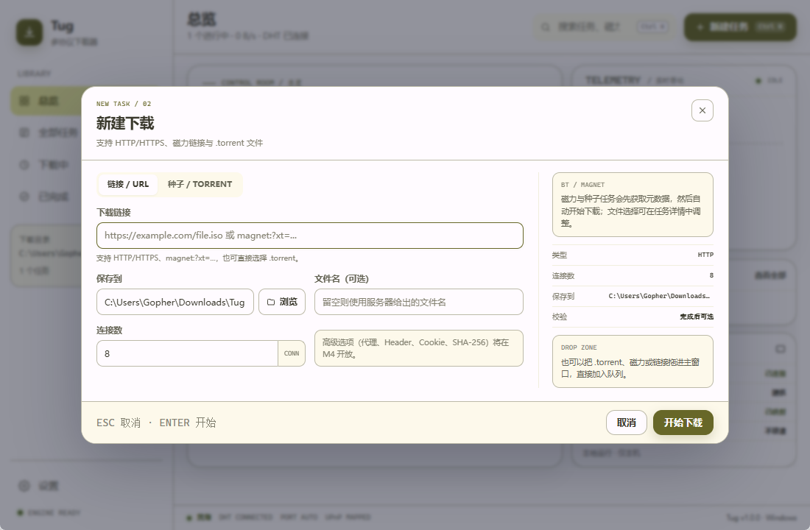

<h1 align="center">
   Tug Desktop
</h1>

<p align="center">Windows 桌面下载器 · HTTP/HTTPS · BitTorrent · 磁力链接 · 多连接 · 断点续传</p>

<p align="center">
  <a href="https://github.com/mtdhllf/Tug-Desktop/releases/latest"></a>
  
  
  
  
</p>

<p align="center">
  当前版本 <b>v1.0.0</b> · Android 版：<a href="https://github.com/mtdhllf/Tug-Android">Tug-Android</a>
</p>

---

## 项目成果

- ✅ 完整的 Windows 桌面下载器：HTTP/HTTPS、BitTorrent、磁力链接统一任务队列
- ✅ Rust 下载核心（HTTP/BT/调度/CLI）+ React 19 + Tauri 2 桌面壳
- ✅ 托盘、通知、单实例、剪贴板检测、拖入种子等桌面集成
- ✅ 与 Android 端一致的橄榄绿 Material 配色与图标
- ✅ NSIS 安装器 + 便携版 zip

## 下载

| 文件 | 说明 |
|---|---|
| [Tug-1.0.0-x64-setup.exe](https://github.com/mtdhllf/Tug-Desktop/releases/download/v1.0.0/Tug-1.0.0-x64-setup.exe) | Windows 10/11 x64 安装器 |
| [Tug-1.0.0-portable.zip](https://github.com/mtdhllf/Tug-Desktop/releases/download/v1.0.0/Tug-1.0.0-portable.zip) | 免安装便携版 |
| [SHA256SUMS.txt](https://github.com/mtdhllf/Tug-Desktop/releases/download/v1.0.0/SHA256SUMS.txt) | 下载校验值 |

更多版本见 [GitHub Releases](https://github.com/mtdhllf/Tug-Desktop/releases)。

## 截图

| 总览 | 全部任务 |
|---|---|
|  |  |

| 设置 | 新建下载 |
|---|---|
|  |  |

## 功能

### 下载

- HTTP/HTTPS 下载，多连接分段加速
- 断点续传与 `.part` 临时文件
- 下载限速（MB/s）、连接数、并发任务数
- 系统代理开关，支持直连/系统代理
- 可选 SHA-256 校验
- 重定向、超时、重试与错误状态

### BitTorrent

- `.torrent` 文件与磁力链接
- DHT、UPnP、监听端口配置
- 文件选择、Peers / Trackers 详情
- 上传限速
- 下载完成后继续共享（可选）
- 重启后恢复未完成任务

### 任务管理

- 总览、全部任务、下载中、已完成
- 下载中列表统一包含：下载中、队列中、已暂停、失败
- 失败任务直接重试
- 搜索、状态筛选、排序、多选
- 暂停、继续、删除任务
- 删除时可选同时删除已下载文件
- 任务持久化到 SQLite

### 桌面集成

- 托盘菜单、关闭到托盘
- 单实例运行
- 下载完成通知
- 剪贴板链接/种子检测（可关闭）
- 拖入 `.torrent` 文件直接新建任务
- 浅色/深色/跟随系统主题
- 中文界面
- 原生标题栏颜色跟随主题

### 设置

- 下载：目录、连接数、并发数
- 网络：系统代理、全局限速
- BitTorrent：DHT、UPnP、端口、上传限速、完成后共享
- 外观：主题、语言
- 通知与托盘
- 关于与诊断

### CLI

- `tug paths` / `tug settings`
- HTTP 下载
- BT 磁力/种子下载

---

## 技术栈

| 层 | 选择 |
|---|---|
| 核心 | Rust 2024 |
| HTTP | reqwest + 分段下载 |
| BT | librqbit |
| 桌面壳 | Tauri 2 + WebView2 |
| UI | React 19 + TypeScript + Vite |
| 存储 | SQLite（任务）+ JSON（设置） |
| 打包 | NSIS（per-user）+ portable zip |

支持 Windows 10/11 x64。

---

## 快速开始

环境要求：

- Rust stable（MSVC 工具链）
- Node.js 22+
- Visual Studio 2022 Build Tools
- WebView2 Runtime

```powershell
cd apps\desktop
npm install
npm run tauri -- dev
```

根目录脚本：

| 脚本 | 作用 |
|---|---|
| `dev.cmd` | 开发模式（Vite + Tauri） |
| `run.cmd` | 构建 release 后启动 |
| `run.cmd debug` | 构建 debug 后启动 |
| `test.cmd` | 前端构建、fmt、clippy、全部测试 |
| `test.cmd quick` | 只跑 Rust 测试 |
| `package.cmd` | 生成 NSIS 安装器 + portable zip |
| `cli.cmd <参数>` | 调用无头 CLI |

---

## 构建与测试

```powershell
# 前端
npm --prefix apps/desktop run check
npm --prefix apps/desktop run build

# Rust
cargo fmt --all -- --check
cargo clippy --workspace --all-targets -- -D warnings
cargo test -p tug-core -p tug-http -p tug-torrent -p tug-service
```

生成安装包：

```powershell
.\package.cmd
```

产物输出到 `artifacts\v1.0.0\`。

---

## 目录

```text
crates/
  tug-core/       # 配置、任务库、日志、路径
  tug-http/       # HTTP 分段下载引擎
  tug-torrent/    # librqbit BT 适配
  tug-service/    # 任务调度、队列、生命周期
  tug-cli/        # 无头 CLI
apps/desktop/
  src/            # React 前端
  src-tauri/      # Tauri 入口与命令
  public/         # 前端静态资源与图标
scripts/          # 根目录脚本共享环境检测
packaging/        # NSIS 打包资源
```

---

## License

Apache License 2.0，详见 [LICENSE](LICENSE)。
